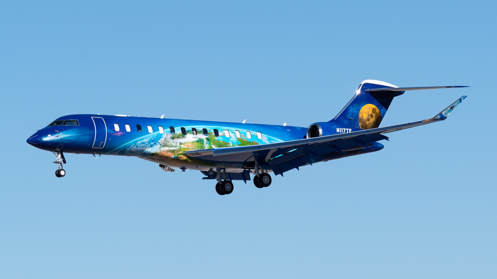
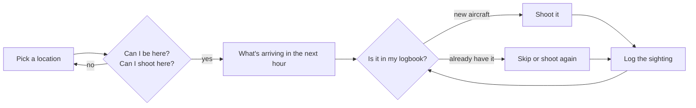
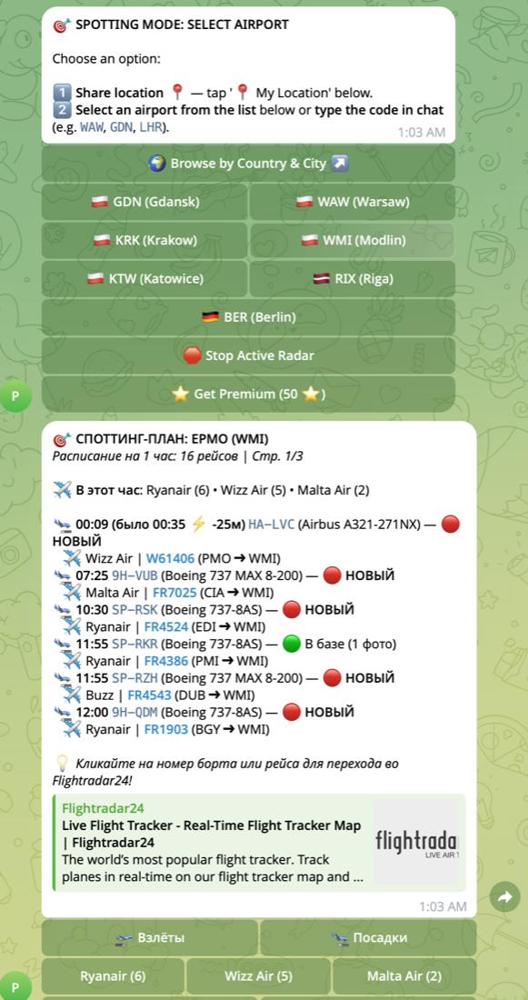
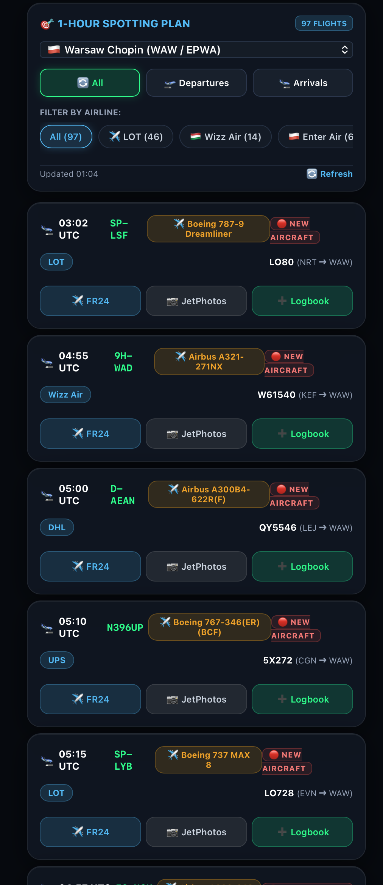
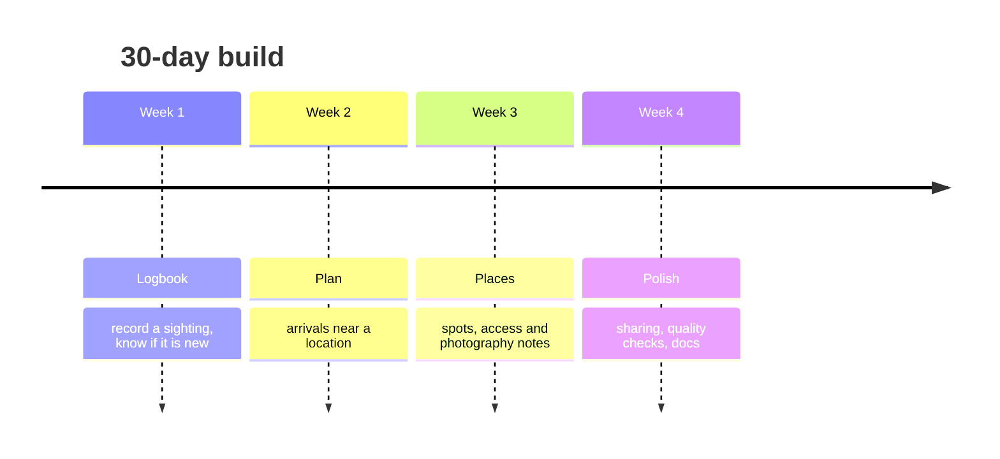

# goSpot

**One place for everything a plane spotter has to juggle: where to stand, whether you're allowed to be there, what's coming in, and which aircraft you still need.**

*N117TE on approach. Photo by the project author, all rights reserved (the MIT license covers the code, not the photos).*

> Status: day 1 of a 30-day build ([Build a Software Factory in 30 Days](https://github.com/orgs/qodo-hackathon/discussions/2)).
> This repo starts with the idea. Code lands one small, reviewed pull request at a time.

## Why

Plane spotting is huge. Hundreds of thousands of people around the world photograph and log aircraft: at the fence of a regional airport, on a hill under the approach path, at a major hub on a Saturday morning. Many do it seriously, with a logbook of every registration they have ever shot.

The hobby has plenty of tools, but each solves one slice:

- a flight tracker for what's in the air
- a photo database for what's already been shot
- a map for finding spots
- a notes app or spreadsheet for the logbook
- forums and chats for "can I actually stand there?"

A spotting session means switching between all of them, often on a phone, often in the cold, often in the short window before the next arrival. Doing it alone gets harder the more intensively you spot.

## The idea

goSpot puts the whole session in one flow:

Four questions it should answer for you:

| Question | What it means |
| --- | --- |
| **Where?** | Find a spotting location near me or near an airport I'm travelling to. |
| **Can I?** | Is it allowed to be there, is photography OK, any restrictions or safety notes? |
| **What's coming?** | Which aircraft will pass over the next hour, and from where? |
| **What do I still need?** | Which of them are new to *my* logbook, and which I already have? |

  
  &nbsp;&nbsp;
  

*Early prototype, a Telegram bot and its web view: pick an airport, see the next hour of arrivals, and each aircraft is flagged "new" or "already in my logbook". The interface is localised (RU/EN/PL); the screenshots are from my own test session.*

## Roadmap

The plan will change as the challenge goes on.

## How this repo is built

Agents write most of the code. Every change comes in as a small pull request and gets an AI review (Qodo) before it merges, so the checks are part of the project from day one. Notes on what the reviews caught and missed will live in [`docs/`](docs/).

## License

[MIT](LICENSE)
